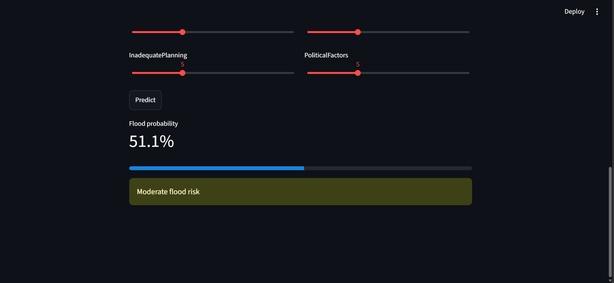

# Flood Prediction 🌊

Machine learning project that predicts the **probability of a flood** from
environmental and human-made factors (monsoon intensity, drainage, urbanization, etc.),
with a Streamlit web app for live predictions.

## Dataset

- Source: Kaggle - *Playground Series S4E5: Regression with a Flood Prediction Dataset*
- Download `train.csv` from Kaggle and place it in the `data/` folder.
- ~1.1 million rows, 20 numeric features, no missing values.
- **Target:** `FloodProbability` (0 to 1) - a **regression** problem.

## Approach

1. **EDA** (`notebooks/eda.ipynb`): target distribution, correlations, feature distributions.
2. **Preprocessing** (`src/preprocess.py`): drop `id`, 80/20 train-test split, a 200k-row sample for fast training, scaling inside a pipeline (no data leakage).
3. **Models** (`src/train.py`): Linear Regression, Random Forest, XGBoost.
4. **Evaluation:** R2, RMSE and MAE on the held-out test set.
5. **Deployment:** best model saved with `joblib` and served through Streamlit.

## Results

Results on the held-out test set (20% split, 200k-row sample):

| Model | R2 | RMSE | MAE |
|---|---|---|---|
| Linear Regression | 0.8456 | 0.0201 | 0.0158 |
| XGBoost | 0.8273 | 0.0212 | 0.0169 |
| Random Forest | 0.5021 | 0.0361 | 0.0295 |

Linear Regression performed best because the features have a nearly linear relationship with flood probability. Random Forest was limited to `max_depth=12` for fast training, which explains its lower score.

Feature importance plot: `results/feature_importance.png`

## How to run

```bash
# 1. setup
python -m venv venv
source venv/bin/activate      # Windows: venv\Scripts\activate
pip install -r requirements.txt

# 2. put train.csv inside data/

# 3. train and save the best model
python src/train.py

# 4. launch the web app
streamlit run app.py
```

## Project structure

```
flood-prediction/
├── data/          # dataset (not tracked by git)
├── notebooks/     # EDA notebook
├── src/
│   ├── load_data.py
│   ├── preprocess.py
│   ├── train.py
│   └── predict.py
├── models/        # saved best model
├── results/       # metrics and plots
├── app.py         # Streamlit app
└── requirements.txt
```

## Screenshot



## Future improvements

- Hyperparameter tuning (Optuna / GridSearchCV)
- Train on the full 1.1M rows
- Try LightGBM / CatBoost
